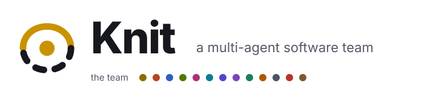
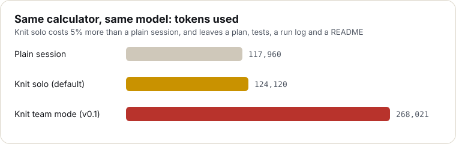
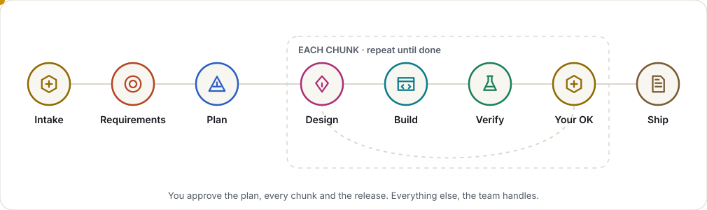
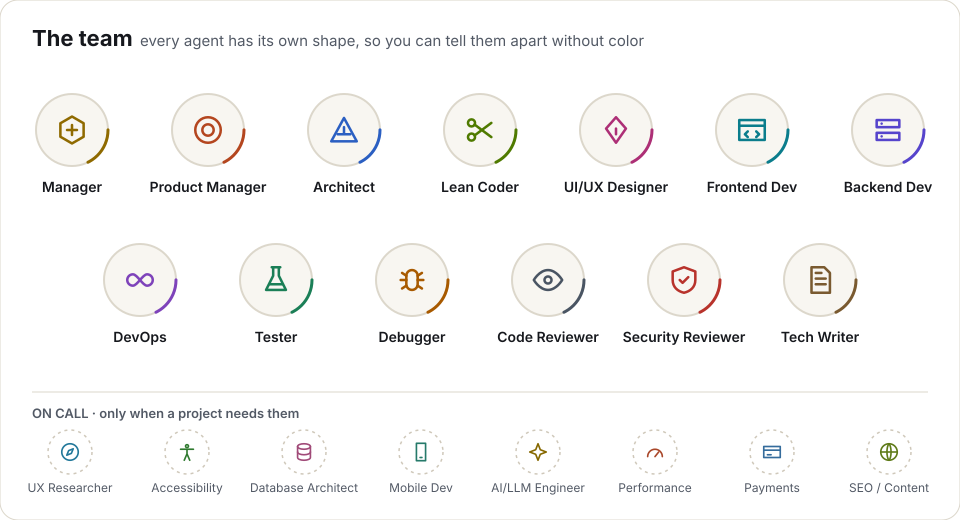
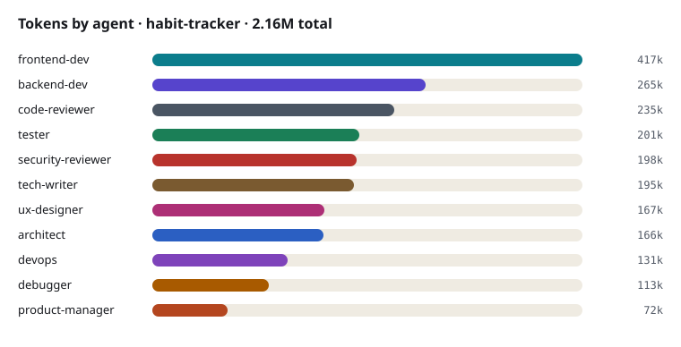
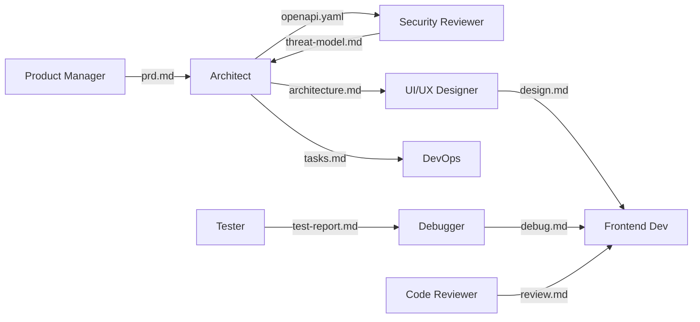
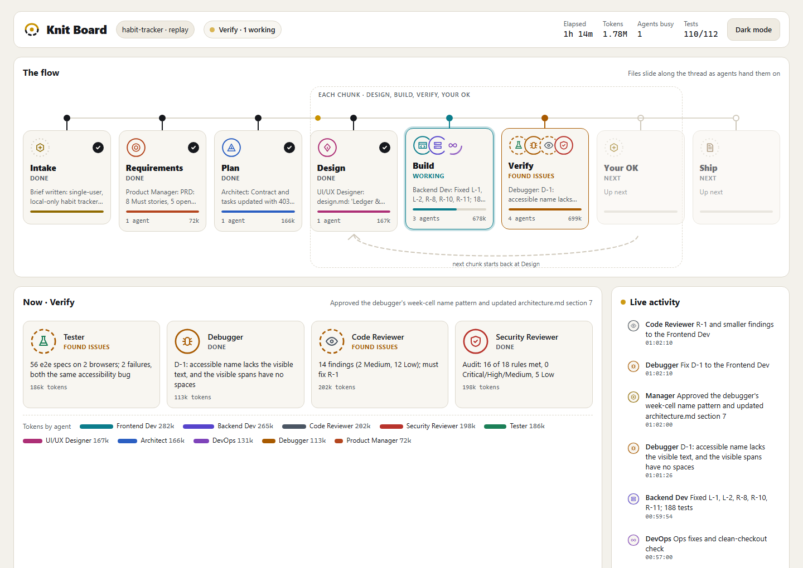

<p align="center">
  <picture>
    <source media="(prefers-color-scheme: dark)" srcset="assets/logo-dark.svg">
    
  </picture>
</p>

<p align="center"><em>You bring the idea. The team asks, plans, builds, tests, reviews and ships it, and you approve each step.</em></p>

<p align="center">
  
  
  
  
  
</p>

---

Knit gives your coding agent a whole team's discipline (product thinking, a lean plan, design polish, tests,
review, docs and a live deploy) **at the cost of one normal session**. It works in Claude Code, Codex, Cursor,
OpenCode and Antigravity. One round of clickable questions, a one-page plan you approve, then the build, slice by
slice. Every step is logged, and nothing goes live without your OK.

**Same cost as a plain session:** on the same calculator, a plain session used 117,960 tokens and Knit used
124,120 (+5%), with less code, more checks, a plan, a run log and a README. [Benchmark](docs/BENCHMARK.md).

<p align="center"></p>

## How it works

<p align="center">
  <picture>
    <source media="(prefers-color-scheme: dark)" srcset="assets/flow-dark.svg">
    
  </picture>
</p>

1. **Intake.** One round of clickable questions: must-haves, stack, where it goes live, solo or team.
2. **Plan.** One page: stories with acceptance checks, the look, the build, the tasks. The Lean checklist cuts what doesn't need to exist. **You approve the plan.**
3. **Build, slice by slice.** Your session puts on each role's hat (Designer, Builder, Tester) using [short checklists](.claude/skills/knit-build/roles.md), with tests only where they pay.
4. **Check and ship.** Tests, lint and build, one Reviewer pass (bugs, security, lean, accessibility, polish), a README with the badge, and a live deploy. **You approve going live.**

**Solo or team.** Solo is the default: one session wears every hat, so it costs what a normal session costs. **Team mode** is opt-in: the specialist agents below work in parallel for speed, and Knit tells you up front that it costs more, because every agent re-reads the project.

## The team (each role is a checklist in solo mode, an agent in team mode)

<p align="center">
  <picture>
    <source media="(prefers-color-scheme: dark)" srcset="assets/team-dark.svg">
    
  </picture>
</p>

<details>
<summary><b>Every agent, its file and its model</b></summary>

| Agent | File | Model | Job |
|---|---|---|---|
| Manager | [`skills/knit-build/SKILL.md`](.claude/skills/knit-build/SKILL.md) | your session | Intake, build mode, gates, delegation, loops, final validation |
| Product Manager | [`product-manager.md`](.claude/agents/product-manager.md) | opus | PRD, `US-` user stories, acceptance criteria |
| Architect | [`architect.md`](.claude/agents/architect.md) | opus | Architecture, `openapi.yaml` contract, tasks grouped into chunks |
| Lean Coder | [`lean-coder.md`](.claude/agents/lean-coder.md) | sonnet | Plan check and trim review: the best code is the code nobody had to write |
| UI/UX Designer | [`ux-designer.md`](.claude/agents/ux-designer.md) | sonnet | Flows, screens, design system and tokens, visual check |
| Frontend Developer | [`frontend-dev.md`](.claude/agents/frontend-dev.md) | sonnet | Web UI from the design and API contract |
| Backend Developer | [`backend-dev.md`](.claude/agents/backend-dev.md) | sonnet | API, auth, data access, migrations |
| Tester | [`tester.md`](.claude/agents/tester.md) | sonnet | Unit, API and Playwright e2e tests mapped to stories |
| Debugger | [`debugger.md`](.claude/agents/debugger.md) | opus | Root cause of failures before anyone fixes |
| Code Reviewer | [`code-reviewer.md`](.claude/agents/code-reviewer.md) | opus | Bugs and contract drift; paired loop until approved |
| Security Reviewer | [`security-reviewer.md`](.claude/agents/security-reviewer.md) | opus | Threat model at design time, audit before release |
| DevOps | [`devops.md`](.claude/agents/devops.md) | sonnet | Tooling, CI/CD, deploy with a smoke test |
| Tech Writer | [`tech-writer.md`](.claude/agents/tech-writer.md) | haiku | README, API docs, changelog from the real code |
| UX Researcher · on call | [`ux-researcher.md`](.claude/agents/ux-researcher.md) | sonnet | Personas, journeys, competitor scan |
| Accessibility Tester · on call | [`accessibility-tester.md`](.claude/agents/accessibility-tester.md) | sonnet | WCAG 2.2 AA for public apps |
| Database Architect · on call | [`database-architect.md`](.claude/agents/database-architect.md) | sonnet | Complex data, scale, query tuning |
| Mobile Developer · on call | [`mobile-developer.md`](.claude/agents/mobile-developer.md) | sonnet | React Native + Expo, or Flutter |
| AI/LLM Engineer · on call | [`ai-engineer.md`](.claude/agents/ai-engineer.md) | sonnet | AI features inside the app |
| Performance Engineer · on call | [`performance-engineer.md`](.claude/agents/performance-engineer.md) | sonnet | Page speed, load, slow queries |
| Payment Integration · on call | [`payment-integration.md`](.claude/agents/payment-integration.md) | sonnet | Stripe or Razorpay, test mode only |
| SEO / Content Writer · on call | [`seo-content-writer.md`](.claude/agents/seo-content-writer.md) | haiku | Marketing pages, meta tags, structured data |

The Manager is a skill run by your main session, because subagents can't start other subagents.
Change any agent's `model:` line to suit your plan.
</details>

## Build mode: in chunks or all at once

| | **In chunks** (default) | **Whole project** |
|---|---|---|
| Best for | Anything bigger than a small app | Small, well-defined apps |
| How | Chunk 0 foundation, then thin end-to-end slices of 1 to 4 stories | One plan, one build |
| You see working software | After chunk 1, then after every chunk | At the end |
| If something is wrong | Caught early, small fix | Caught late, bigger fix |

## A team-mode run

Team mode's first test built a local habit tracker with 11 agents. It worked, but it cost 2.16M tokens, which is
why solo mode became the default. Every number below comes from its run log.

| 11 agents · 22 runs | 2h 12m of agent time | 2.16M tokens | 197 unit/API tests | 112 / 112 e2e | Review: approved in round 2 |
|:---:|:---:|:---:|:---:|:---:|:---:|

<p align="center"></p>



Read the full [run report](docs/examples/habit-tracker/run-report.md) and [token report](docs/examples/habit-tracker/token-report.md).

## Watch the team work: Knit Board

<p align="center">
  <picture>
    <source media="(prefers-color-scheme: dark)" srcset="assets/board-dark.png">
    
  </picture>
</p>

```bash
node board/server.mjs ../my-project            # live: follows .knit/events.jsonl as the team works
node board/server.mjs ../my-project --replay   # replays a finished run step by step
```

`/knit-build` starts it for you and it opens in your browser. Each station card shows its agents, what they're doing, and its tokens.
Files slide along the thread when one agent hands them to another; a file going backwards is a fix loop.
Below the flow, **Now** shows who is working, the **Watchguard** watches for anything stuck and shows the quality card once it passes, and the feed lists every step. The header shows the Knit version and tells you when an update is out. Light and dark.
No dependencies and no build step; it only listens on 127.0.0.1.

## Every run is logged and reported

The Manager appends each step to `.knit/events.jsonl` ([format](docs/EVENTS.md)). One command turns it into reports:

```bash
node scripts/knit-report.mjs ../my-project
```

| Output | What's in it |
|---|---|
| `run-report.md` | How the team worked together: timeline, handoff graph, every agent run, debug loops, review rounds, gates, lessons |
| `token-report.md` | Tokens, tool uses and time per agent, with each agent's share |
| `tokens.svg` | The chart above, in light and dark |

## Docs in Notion

When a Notion connector is available, Knit asks at intake whether to keep the docs in Notion. If you say yes,
the Manager keeps a page per project under **Knit Projects** in your workspace: brief, PRD, architecture,
design, test and review results, run report and token report, updated at every gate. The files in `.knit/`
stay the source of truth; Notion is the readable, shareable copy.

## Quick start

1. Clone this repo and open Claude Code in the `knit` folder, so the agents and the skill load.
2. Type `/knit-build` and your idea, e.g. `/knit-build a habit tracker with daily check-ins and streaks`.
3. Answer the questions. The team builds in a sibling folder (`../<project-name>`).

## Works in your tool

```bash
node scripts/install.mjs <claude|codex|cursor|opencode|antigravity|all> --target ../my-project
```

| Tool | Agents run as | Parallel builders | Clickable questions |
|---|---|:---:|:---:|
| Claude Code | Subagents | ✓ | ✓ |
| Cursor | Subagents | ✓ | |
| OpenCode | Subagents | ✓ | |
| Codex | Subagents, when the Manager names them | ✓ | |
| Antigravity | One agent playing each role in turn | | |

Add `--global` to install for every project on your computer. Details: [docs/PORTABILITY.md](docs/PORTABILITY.md).

## Docs

| | |
|---|---|
| [docs/PORTABILITY.md](docs/PORTABILITY.md) | How Knit installs into Codex, Cursor, OpenCode and Antigravity |
| [docs/EVENTS.md](docs/EVENTS.md) | The run log format behind the reports, Notion pages and the coming Knit Board |
| [docs/ROLES.md](docs/ROLES.md) | Every role in MetaGPT, ChatDev, CrewAI, AutoGen, OpenHands, wshobson/agents and VoltAgent, mapped to Knit |
| [docs/SKILLS.md](docs/SKILLS.md) | Skills and MCP connectors per agent |
| [docs/REFERENCES.md](docs/REFERENCES.md) | Projects Knit learns from |

The README graphics are drawn by `node scripts/build-assets.mjs` from the shared agent palette in `scripts/palette.mjs`.

## Roadmap

- [x] Agent roster, Manager playbook, paired review loop, model per agent
- [x] Multiple-choice intake, chunk or whole-project build mode, Lean Coder
- [x] First test run: a habit tracker built end to end
- [x] Run log, run report and token usage report
- [x] Visual README
- [x] Docs in Notion
- [x] Works in Codex, Cursor, OpenCode and Antigravity
- [x] Knit Board: a live UI of the agents at work
- [x] Version shown everywhere, update notice, Watchguard, quality card ([changelog](CHANGELOG.md))
- [x] Solo by default: same cost as a plain session ([benchmark](docs/BENCHMARK.md))
- [ ] Project templates (Next.js + FastAPI, Next.js full-stack, Expo mobile)
- [ ] Hooks: block edits to `.env`, run lint and tests after each agent finishes
- [ ] Standalone runner on the Claude Agent SDK

## Credits

The Lean Coder's reuse-first ladder is inspired by [Ponytail](https://github.com/DietrichGebert/ponytail) (MIT).
Role ideas come from [MetaGPT](https://github.com/FoundationAgents/MetaGPT), [ChatDev](https://github.com/OpenBMB/ChatDev),
[wshobson/agents](https://github.com/wshobson/agents) and [VoltAgent's subagents](https://github.com/VoltAgent/awesome-claude-code-subagents).
