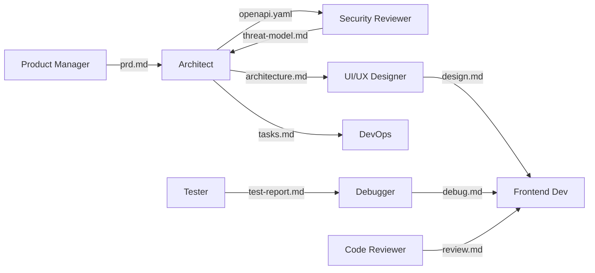

<p align="center">
  <picture>
    <source media="(prefers-color-scheme: dark)" srcset="assets/logo-dark.svg">
    
  </picture>
</p>

<p align="center"><em>You bring the idea. The team asks, plans, builds, tests, reviews and ships it, and you approve each step.</em></p>

<p align="center">
  
  
  
  
  
</p>

---

Knit is a team of specialist AI agents for Claude Code. A **Manager** asks you a few multiple-choice
questions, then a Product Manager, Architect, Designer, Developers, Tester, Debugger, Reviewers and a
Writer take the project from idea to working, tested code. Every handoff is a readable file, every step
is logged, and nothing ships without your OK.

## How it works

<p align="center">
  <picture>
    <source media="(prefers-color-scheme: dark)" srcset="assets/flow-dark.svg">
    
  </picture>
</p>

1. **Intake.** Up to two rounds of clickable questions: what you're building, for whom, chunks or whole project, stack, must-haves.
2. **Requirements and plan.** A PRD with numbered user stories, an architecture, an API contract and a task list. The Lean Coder cuts what doesn't need to be built; Security writes a threat model. **You approve the plan.**
3. **Each chunk.** Design, then builders in parallel, then tests, a debug loop, and three reviewers (code, lean, security) until the code reviewer approves. **You approve each chunk.**
4. **Ship.** Docs, a clean-checkout check, and a final check of every acceptance criterion. **You approve the release.**

## The team

<p align="center">
  <picture>
    <source media="(prefers-color-scheme: dark)" srcset="assets/team-dark.svg">
    
  </picture>
</p>

<details>
<summary><b>Every agent, its file and its model</b></summary>

| Agent | File | Model | Job |
|---|---|---|---|
| Manager | [`skills/knit/SKILL.md`](.claude/skills/knit/SKILL.md) | your session | Intake, build mode, gates, delegation, loops, final validation |
| Product Manager | [`product-manager.md`](.claude/agents/product-manager.md) | opus | PRD, `US-` user stories, acceptance criteria |
| Architect | [`architect.md`](.claude/agents/architect.md) | opus | Architecture, `openapi.yaml` contract, tasks grouped into chunks |
| Lean Coder | [`lean-coder.md`](.claude/agents/lean-coder.md) | sonnet | Plan check and trim review: the best code is the code nobody had to write |
| UI/UX Designer | [`ux-designer.md`](.claude/agents/ux-designer.md) | sonnet | Flows, screens, design system and tokens, visual check |
| Frontend Developer | [`frontend-dev.md`](.claude/agents/frontend-dev.md) | sonnet | Web UI from the design and API contract |
| Backend Developer | [`backend-dev.md`](.claude/agents/backend-dev.md) | sonnet | API, auth, data access, migrations |
| Tester | [`tester.md`](.claude/agents/tester.md) | sonnet | Unit, API and Playwright e2e tests mapped to stories |
| Debugger | [`debugger.md`](.claude/agents/debugger.md) | opus | Root cause of failures before anyone fixes |
| Code Reviewer | [`code-reviewer.md`](.claude/agents/code-reviewer.md) | opus | Bugs and contract drift; paired loop until approved |
| Security Reviewer | [`security-reviewer.md`](.claude/agents/security-reviewer.md) | opus | Threat model at design time, audit before release |
| DevOps | [`devops.md`](.claude/agents/devops.md) | sonnet | Tooling, CI/CD, deploy with a smoke test |
| Tech Writer | [`tech-writer.md`](.claude/agents/tech-writer.md) | haiku | README, API docs, changelog from the real code |
| UX Researcher · on call | [`ux-researcher.md`](.claude/agents/ux-researcher.md) | sonnet | Personas, journeys, competitor scan |
| Accessibility Tester · on call | [`accessibility-tester.md`](.claude/agents/accessibility-tester.md) | sonnet | WCAG 2.2 AA for public apps |
| Database Architect · on call | [`database-architect.md`](.claude/agents/database-architect.md) | sonnet | Complex data, scale, query tuning |
| Mobile Developer · on call | [`mobile-developer.md`](.claude/agents/mobile-developer.md) | sonnet | React Native + Expo, or Flutter |
| AI/LLM Engineer · on call | [`ai-engineer.md`](.claude/agents/ai-engineer.md) | sonnet | AI features inside the app |
| Performance Engineer · on call | [`performance-engineer.md`](.claude/agents/performance-engineer.md) | sonnet | Page speed, load, slow queries |
| Payment Integration · on call | [`payment-integration.md`](.claude/agents/payment-integration.md) | sonnet | Stripe or Razorpay, test mode only |
| SEO / Content Writer · on call | [`seo-content-writer.md`](.claude/agents/seo-content-writer.md) | haiku | Marketing pages, meta tags, structured data |

The Manager is a skill run by your main session, because subagents can't start other subagents.
Change any agent's `model:` line to suit your plan.
</details>

## Build mode: in chunks or all at once

| | **In chunks** (default) | **Whole project** |
|---|---|---|
| Best for | Anything bigger than a small app | Small, well-defined apps |
| How | Chunk 0 foundation, then thin end-to-end slices of 1 to 4 stories | One plan, one build |
| You see working software | After chunk 1, then after every chunk | At the end |
| If something is wrong | Caught early, small fix | Caught late, bigger fix |

## A real run

The first test run built a local habit tracker end to end. Every number below comes from its run log.

| 11 agents · 22 runs | 2h 12m of agent time | 2.16M tokens | 197 unit/API tests | 112 / 112 e2e | Review: approved in round 2 |
|:---:|:---:|:---:|:---:|:---:|:---:|

<p align="center"></p>



Read the full [run report](docs/examples/habit-tracker/run-report.md) and [token report](docs/examples/habit-tracker/token-report.md).

## Every run is logged and reported

The Manager appends each step to `.knit/events.jsonl` ([format](docs/EVENTS.md)). One command turns it into reports:

```bash
node scripts/knit-report.mjs ../my-project
```

| Output | What's in it |
|---|---|
| `run-report.md` | How the team worked together: timeline, handoff graph, every agent run, debug loops, review rounds, gates, lessons |
| `token-report.md` | Tokens, tool uses and time per agent, with each agent's share |
| `tokens.svg` | The chart above, in light and dark |

## Docs in Notion

When a Notion connector is available, Knit asks at intake whether to keep the docs in Notion. If you say yes,
the Manager keeps a page per project under **Knit Projects** in your workspace: brief, PRD, architecture,
design, test and review results, run report and token report, updated at every gate. The files in `.knit/`
stay the source of truth; Notion is the readable, shareable copy.

## Quick start

1. Clone this repo and open Claude Code in the `knit` folder, so the agents and the skill load.
2. Type `/knit` and your idea, e.g. `/knit a habit tracker with daily check-ins and streaks`.
3. Answer the questions. The team builds in a sibling folder (`../<project-name>`).

To use the team in another repo, copy `.claude/agents/` and `.claude/skills/knit/` into it, or into
`~/.claude/` to have it everywhere.

## Docs

| | |
|---|---|
| [docs/EVENTS.md](docs/EVENTS.md) | The run log format behind the reports, Notion pages and the coming Knit Board |
| [docs/ROLES.md](docs/ROLES.md) | Every role in MetaGPT, ChatDev, CrewAI, AutoGen, OpenHands, wshobson/agents and VoltAgent, mapped to Knit |
| [docs/SKILLS.md](docs/SKILLS.md) | Skills and MCP connectors per agent |
| [docs/REFERENCES.md](docs/REFERENCES.md) | Projects Knit learns from |

The README graphics are drawn by `node scripts/build-assets.mjs` from the shared agent palette in `scripts/palette.mjs`.

## Roadmap

- [x] Agent roster, Manager playbook, paired review loop, model per agent
- [x] Multiple-choice intake, chunk or whole-project build mode, Lean Coder
- [x] First test run: a habit tracker built end to end
- [x] Run log, run report and token usage report
- [x] Visual README
- [x] Docs in Notion
- [ ] Works in Codex, Cursor, OpenCode and Antigravity
- [ ] Knit Board: a live UI of the agents at work
- [ ] Project templates (Next.js + FastAPI, Next.js full-stack, Expo mobile)
- [ ] Hooks: block edits to `.env`, run lint and tests after each agent finishes
- [ ] Standalone runner on the Claude Agent SDK

## Credits

The Lean Coder's reuse-first ladder is inspired by [Ponytail](https://github.com/DietrichGebert/ponytail) (MIT).
Role ideas come from [MetaGPT](https://github.com/FoundationAgents/MetaGPT), [ChatDev](https://github.com/OpenBMB/ChatDev),
[wshobson/agents](https://github.com/wshobson/agents) and [VoltAgent's subagents](https://github.com/VoltAgent/awesome-claude-code-subagents).
