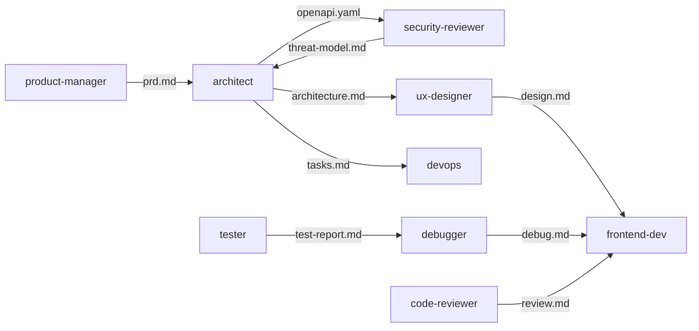

# How the team worked: habit-tracker

## Summary

- **When:** 2026-10-16T23:48:00+05:30 to 2026-10-17T09:42:00+05:30
- **Team:** 11 agents, 22 agent runs, 2h 12m of agent time, 2,158,475 tokens ([token report](token-report.md))
- **Handoffs:** 9 · **Debug loops:** 1 · **Code review rounds:** 2 · **Gates:** 2
- **Last test run:** Clean checkout: npm ci, lint, typecheck, 197 tests, build and 112 e2e all pass (112 passed, 0 failed)

## Timeline

| Time | Type | Who | What |
|---|---|---|---|
| 23:48 | phase | manager | Brief written: single-user, local-only habit tracker; whole-project mode |
| 23:50 | decision | manager | Answered the 5 PRD questions with defaults: archive only, streak counts from yesterday, rate since creation, 8-color palette, 50-char names |
| 23:51 | phase | manager | Planning starts |
| 23:59 | gate | user | Gate 1: plan approved (local-only build requested up front) |
| 00:04 | decision | manager | Add a 403 FORBIDDEN error to the contract; loopback only for v1 (no LAN mode) |
| 00:16 | commit | manager | Knit wave 0: brief, PRD, architecture, OpenAPI contract, threat model, design, scaffold |
| 00:22 | commit | manager | Knit wave A: security hardening (SR-1,5,9,13-18), theme and UI primitives |
| 00:24 | commit | manager | Knit task 3: Prisma schema, init migration, db client, generated API types |
| 00:40 | commit | manager | Knit build: tasks 4-13 (stats logic, API, check-offs, client, Today view, week strip, dialogs, stats page) |
| 00:40 | phase | manager | Verify starts: tester, code reviewer and security audit in parallel |
| 00:45 | review | security-reviewer | Security audit: no Critical, High or Medium findings; 5 Low |
| 00:46 | review | code-reviewer | Code review round 1: CHANGES REQUESTED (must fix R-1) |
| 00:55 | test | tester | E2E round 1: 110 of 112 passed |
| 00:56 | commit | manager | Knit verify: e2e suite (110/112), test report, code review, security audit |
| 01:02 | decision | manager | Approved the debugger's week-cell name pattern and updated architecture.md section 7 |
| 09:26 | commit | manager | Knit fix round: backend review fixes (L-1, L-2, R-8, R-10, R-11), ops backups and CSP, debug D-1, week-cell name contract |
| 09:31 | commit | manager | Knit fix round: frontend R-1..R-4, R-6, R-12, stale stats, D-1 week-cell names; e2e specs updated |
| 09:34 | review | code-reviewer | Code review round 2: APPROVED |
| 09:36 | test | tester | E2E round 2: 112 of 112 passed |
| 09:36 | commit | manager | Knit verify round 2: review APPROVED, e2e 112/112 |
| 09:37 | phase | manager | Ship: docs and clean-checkout check in parallel |
| 09:40 | test | manager | Clean checkout: npm ci, lint, typecheck, 197 tests, build and 112 e2e all pass |
| 09:41 | commit | manager | Knit ship: README, API docs, changelog, clean-checkout check, final validation |
| 09:41 | gate | user | Gate 3: local build accepted; nothing pushed or deployed |

## Who handed what to whom

## Agent runs

| # | Agent | Task | Result | Tokens | Time | Note |
|---:|---|---|---|---:|---:|---|
| 1 | product-manager |  | done | 72,485 | 2m | PRD: 8 Must stories, 5 open questions |
| 2 | architect |  | done | 129,408 | 8m | 16 tasks in 6 waves, 9-operation API contract, no optional specialists |
| 3 | security-reviewer |  | done | 117,803 | 4m | Threat model: 18 security rules (SR-1 to SR-18), 2 decisions for the Manager |
| 4 | ux-designer | 2 | done | 166,706 | 9m | design.md: 'Ledger & thread' look, 6 screens, tokens with AA contrast, wireframe sheet |
| 5 | architect |  | done | 36,106 | 10m | Contract and tasks updated with 403 and SR-1 to SR-18 |
| 6 | devops | 1 | done | 100,183 | 12m | Scaffold: Next 16.4, React 19.1, Prisma 6.19, Tailwind 4; lint, typecheck, build pass |
| 7 | frontend-dev | 8 | done | 141,543 | 4m | Theme, app shell, Button, Dialog, Toast, HabitBadge |
| 8 | devops | 1 follow-up | done | 31,089 | 5m | 9 security rules applied; prod audit from 3 high to 0 |
| 9 | backend-dev | 3 | done | 113,156 | 2m | Prisma schema, first migration, generated API types |
| 10 | frontend-dev | 9-13 | done | 140,453 | 12m | Tasks 9-13 built; 67 unit tests; XSS check passes |
| 11 | backend-dev | 4-7 | done | 129,205 | 15m | Tasks 4-7 built; 165 tests; GET /api/today 79 ms with 20 habits x 365 days |
| 12 | security-reviewer |  | passed | 80,088 | 5m | Audit: 16 of 18 rules met, 0 Critical/High/Medium, 5 Low |
| 13 | code-reviewer |  | changes_requested | 201,781 | 6m | 14 findings (2 Medium, 12 Low); must fix R-1 |
| 14 | tester |  | found_issues | 186,359 | 15m | 56 e2e specs on 2 browsers; 2 failures, both the same accessibility bug |
| 15 | backend-dev |  | done | 22,571 | 3m | Fixed L-1, L-2, R-8, R-10, R-11; 188 tests |
| 16 | debugger |  | done | 112,561 | 4m | D-1: accessible name lacks the visible text, and the visible spans have no spaces |
| 17 | devops |  | stopped | 0 | - | Stopped by the user during the clean-checkout check; its 3 fixes were kept |
| 18 | tester |  | done | 11,228 | 1m | Specs updated for the new week-cell names |
| 19 | frontend-dev |  | done | 134,527 | 5m | Fixed R-1, R-2, R-3, R-4, R-6, R-12, stale stats and D-1; 197 tests |
| 20 | code-reviewer |  | approved | 32,778 | 2m | All 9 requested fixes confirmed |
| 21 | tester |  | passed | 3,207 | 5m | 197 unit/API tests and 112 of 112 e2e, run twice |
| 22 | tech-writer | 15 | done | 195,238 | 3m | README, docs/api.md and changelog; flagged 4 contract and code mismatches |

## Notes and lessons

- The run paused overnight on a usage limit. Stopped agents can't be resumed, so the frontend fix round restarted with a fresh agent and the Manager ran the clean-checkout check itself.
- Usage numbers are exact. Times between commits are approximate. For agents resumed several times, tokens are the growth in context since the previous hand-back.
- Lesson: start the threat model before scaffolding, so the security rules land in task 1 instead of a follow-up.
- Lesson: give each parallel agent its own port and database file; two agents briefly collided on a dev server.
- Lesson: the paired review loop worked: one must-fix in round 1, approved in round 2.
